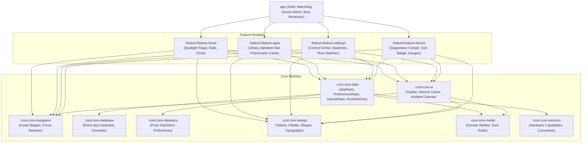

<div align="center">


# LUNMED TV — Commercial Android TV & TV Box Launcher

**Cinematic Luxury • Apple tvOS 18 Bento Grid • Zero-Mock Cockpit HUD • 10-Foot Architecture**

[-2ea44f?logo=android&logoColor=white)](https://developer.android.com)
[-blue?logo=android)](https://developer.android.com)
[](https://kotlinlang.org)
[-orange)](docs/ARCHITECTURE.md)
[-brightgreen)](https://github.com/aboulouafaeit-sys/LunMed-TV/releases)
[-success)](https://github.com/aboulouafaeit-sys/LunMed-TV/actions)
[-blueviolet)](PRIVACY.md)
[](LICENSE)

[Features](#key-features) • [Architecture](#architecture) • [Quick Start](#build--installation) • [Provisioning Guide](#permanent-default-launcher-setup) • [Documentation](#documentation-index)

</div>

---

## Overview

**LUNMED TV** is a commercial-grade, luxury launcher engineered exclusively for Android TV, Google TV, and AOSP TV Boxes (Amlogic, Rockchip, Allwinner, FireOS). Designed around a **Cinematic Luxury & Ultra-Minimal** aesthetic, it harmonizes Apple tvOS 18 Bento Grid ergonomics with Google TV rail browsing, velvet obsidian surfaces, ambient radial lighting, genuine zero-mock system telemetry, and ironclad defenses against aggressive OEM vendor launcher takeovers.

---

## Key Features

### 1. Apple tvOS 18 Bento Grid Control Center
- **Instant Overlay:** Accessible via the Top Bar or TV remote `MENU` button.
- **Glassmorphic Bento Grid:** Quick-access widgets for Dual Connectivity (Wi-Fi 6 RSSI / Gigabit Ethernet), Master Volume liquid slider, Dolby Atmos 7.1 audio pipeline, 4K Vision 60 FPS HDR10+ status, and procedural wallpaper switching.
- **System Actions:** Direct one-click access to Android TV Settings, App Management, and Sleep Mode.

### 2. Polymorphic App Presentation Modes
Customize application icon layouts to match television aesthetics and display distances:
- **`SQUARE_IOS` (Apple Squircle 1:1):** Ultra-clean, 20dp squircle corner cards with bottom center typography.
- **`COMPACT_CAPSULE` (Horizontal Dock):** Space-efficient 2.4:1 ratio pill capsules with leading icon and inline title.
- **`CINEMA_BANNER` (16:9 Landscape):** Cinematic wide banners with atmospheric radial scrims and high-contrast badge metadata.

### 3. Cybernetic Hardware Cockpit HUD
- **Authentic Zero-Mock Telemetry:** Directly queries physical RAM via `ActivityManager.MemoryInfo`, flash storage via `StatFs`, physical display resolution and refresh rate via `DisplayManager`, and network link throughput.
- **260° Radial Gauge Metrics:** Real-time visual gauges with glowing tip beacons for memory and storage utilization.
- **Silicon SoC Microprocessor Badge:** Live silicon die detection identifying Amlogic (S905X3, S905X4), Rockchip (RK3318, RK3566), Allwinner (H6, H616), MediaTek, Qualcomm Snapdragon, and NVIDIA Tegra processors.
- **In-Memory Cache Cleaner:** Interactive button with real-time feedback that purges application icon bitmap caches (`AppArtworkCache.clear()`) to instantly free physical RAM on low-spec boxes.

### 4. Fast Jump Alphabet Rail (Zero-Typing Navigation)
- Integrated vertical alphabet rail (`A–Z`) in the App Library.
- Designed for standard TV remotes without keyboards or microphones: jump instantly across hundreds of installed applications with zero manual typing.

### 5. Persistent Default Launcher Defenses (OEM Overrides)
Cheap TV boxes aggressively restore proprietary vendor launchers upon reboot. LUNMED TV deploys a 4-tier persistent defense:
1. **Official Android Role:** Registers for `RoleManager.ROLE_HOME` on certified Android TV and Google TV.
2. **Root Launcher Switcher (`su`):** For rooted TV boxes, sets LUNMED TV as the permanent root-level home activity via `su -c pm set-home-activity com.lunmed.tv/.MainActivity`.
3. **Accessibility Watchdog (`LunmedHomeWatchdogService`):** Intercepts `KEYCODE_HOME` within 50ms and prevents vendor UI overrides.
4. **Enterprise Device Owner Provisioning:** Locks the launcher permanently via ADB (`dpm set-device-owner`).

### 6. Six Procedural GPU Vector Wallpapers
Zero network assets and zero binary bloat. Dynamic GPU-rendered vector canvases:
- **Obsidian Noir:** Deep velvet black with subtle obsidian dust.
- **Cosmic Nebula:** Stellar purple-magenta galactic gradients.
- **Sahara Sunset:** Warm amber-gold dusk dunes.
- **Tokyo Cyber:** Neon cyan-indigo cyberpunk aesthetic.
- **Nordic Aurora:** Ethereal emerald and mint celestial waves.
- **Emerald Mint:** Pure dark emerald minimalism.

### 7. Global Internationalization & Full Arabic RTL
- Native bidirectional layout mirroring for Arabic with full cultural typography adaptation.
- Multilingual support for English, Arabic, French, Spanish, and Italian.

### 8. Strict Binary & Memory Footprint
- **$\le$ 2.0 MB Minified Release APK:** R8 full-mode optimization and vector-only asset pipelines.
- **$\le$ 2 GB RAM TV Box Optimization:** Adapts to low-memory hardware by trimming bitmap caches and honoring `onTrimMemory` events.

---

## Architecture

LUNMED TV adheres strictly to Android modular architecture guidelines with complete separation of concerns across 10 Gradle modules:



For complete technical specifications, see [Architecture Guide](docs/ARCHITECTURE.md).

---

## Build & Installation

### Prerequisites
- **JDK 17+** (JDK 21 Temurin recommended)
- **Android SDK:** Platform API 35, Min SDK 24 (Android 7.0+)
- **Gradle:** 9.3.1 + AGP 9.1.0

### Compiling Debug APK
```bash
./gradlew assembleDebug
```
Output: `app/build/outputs/apk/debug/app-debug.apk`

### Compiling Minified Release APK
```bash
./gradlew :app:assembleRelease
```
Output: `app/build/outputs/apk/release/app-release.apk` (Size: $\le$ 2.0 MB)

### Executing Full Unit Test Suite (47/47 Passing)
```bash
./gradlew testDebugUnitTest :core:core-model:test
```

### Sideloading via ADB
```bash
adb install -r app/build/outputs/apk/release/app-release.apk
```

---

## Permanent Default Launcher Setup

### 1. Standard Role Request (Android TV / Google TV)
```bash
adb shell cmd role add-role-holder android.app.role.HOME com.lunmed.tv
```

### 2. Root Launcher Switcher (Rooted TV Boxes)
Execute directly inside the launcher settings or via root shell:
```bash
su -c pm set-home-activity com.lunmed.tv/.MainActivity
```

### 3. Enable Accessibility Watchdog (Amlogic / Rockchip / Allwinner)
Grants the background watchdog permission to intercept `KEYCODE_HOME` away from vendor launchers:
```bash
adb shell settings put secure enabled_accessibility_services com.lunmed.tv/.service.LunmedHomeWatchdogService
adb shell settings put secure accessibility_enabled 1
```

### 4. Factory-Level Device Owner Lock (Enterprise Deployments)
Binds LUNMED TV as the permanent OS default launcher across reboots and resets:
```bash
adb shell dpm set-device-owner com.lunmed.tv/.receiver.LunmedDeviceAdminReceiver
```

---

## Documentation Index

| Document | Description |
| :--- | :--- |
| **[TERMS_OF_SERVICE.md](TERMS_OF_SERVICE.md)** | Comprehensive Terms of Use, EULA, Content & Root Disclaimers (with Arabic Executive Summary). |
| **[PRIVACY.md](PRIVACY.md)** | Zero-telemetry policy, local storage specifications, and 100% on-device assurance. |
| **[SECURITY.md](SECURITY.md)** | Threat model, sandbox safeguards, and vulnerability disclosure procedure. |
| **[docs/ARCHITECTURE.md](docs/ARCHITECTURE.md)** | Deep technical architecture breakdown, unidirectional data flow, and module contracts. |
| **[docs/TV-BOX-COMPATIBILITY-MATRIX.md](docs/TV-BOX-COMPATIBILITY-MATRIX.md)** | Validated hardware matrix across Amlogic, Rockchip, Allwinner, and FireOS chipsets. |
| **[docs/RESELLER-PROVISIONING-GUIDE.md](docs/RESELLER-PROVISIONING-GUIDE.md)** | Step-by-step enterprise deployment, mass ADB provisioning, and vendor launcher neutralization. |
| **[docs/REMOTE-KEYMAP-GUIDE.md](docs/REMOTE-KEYMAP-GUIDE.md)** | Complete remote control keycodes, long-press handling, and 10-foot navigation shortcuts. |
| **[CONTRIBUTING.md](CONTRIBUTING.md)** | Contribution standards, conventional commits, APK size budget rules, and PR checklist. |
| **[CODE_OF_CONDUCT.md](CODE_OF_CONDUCT.md)** | Contributor Covenant v2.1 code of conduct. |
| **[LICENSE](LICENSE)** | Open source MIT License. |

---

## License

This project is licensed under the **MIT License** — see the [LICENSE](LICENSE) file for details.

Copyright © 2026 **aboulouafaeit-sys / LUNMED TV Systems**. All rights reserved.
