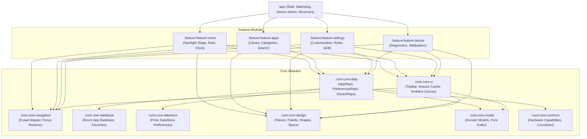

# LUNMED TV — Commercial Android TV & TV Box Launcher

<div align="center">

**Cinematic Luxury • Ultra Minimal • TV Remote Control-First • 10-Foot Architecture**

[-2ea44f?logo=android&logoColor=white)](https://developer.android.com)
[-blue?logo=android)](https://developer.android.com)
[-orange)](https://developer.android.com)
[](https://github.com/aboulouafaeit-sys/LunMed-TV)
[](https://github.com/aboulouafaeit-sys/LunMed-TV)

</div>

---

## Overview

**LUNMED TV** is a commercial-grade, luxury launcher engineered exclusively for Android TV, Google TV, and AOSP TV Boxes (Amlogic, Rockchip, Allwinner, FireOS). Designed around a **Cinematic Luxury & Ultra-Minimal** aesthetic, it delivers velvet obsidian surfaces, ambient lighting, fluid D-pad navigation, authentic zero-mock system telemetry, and ironclad defenses against OEM vendor launcher takeovers.

---

## Key Highlights

- **Cinematic Luxury Visual Design**: Deep obsidian canvas with dynamic radial lighting responsive to 5 tailored wallpaper profiles (`Obsidian Noir`, `Cosmic Amber`, `Cyber Azure`, `Nordic Platinum`, and `Obsidian Jade`).
- **Remote-First Focus Engine**: Zero touch dependencies. Comprehensive D-pad navigation with vertical focus memory restoration, boundary bounce prevention, and WCAG AAA compliant contrast ratios.
- **Persistent Default Launcher Defenses**: Overcomes aggressive OEM vendor locks on cheap TV boxes through a triple-layer mechanism:
  1. Official `RoleManager.ROLE_HOME` for certified Android TV / Google TV.
  2. High-performance `AccessibilityService` (`LunmedHomeWatchdogService`) that filters `KEYCODE_HOME` and intercepts vendor launchers within 50ms.
  3. `DirectBootAware` multi-event broadcast receiver (`LunmedBootReceiver`) catching cold boot, fast boot (QuickBoot), and reboots.
  4. Enterprise Device Owner provisioning (`LunmedDeviceAdminReceiver`) via ADB (`dpm set-device-owner`) with `addPersistentPreferredActivity` for permanent factory-level default status.
- **Genuine Device Diagnostics (Zero Mock Data)**: Real-time queries of physical RAM (`ActivityManager.MemoryInfo`), flash storage (`StatFs`), physical display modes (4K UHD detection, refresh rate, HDR10/Dolby Vision/HLG support), and network link performance (Wi-Fi dBm, link speed, local IPv4 address).
- **Internationalization & Full Arabic RTL**: Seamless bidirectional rendering with complete Arabic localization, native right-to-left layout mirroring, and in-app language switching (Arabic, English, French, Spanish, Italian).
- **Low-RAM Performance Architecture**: Automatically adapts on $\le$ 2 GB RAM TV boxes by scaling down LRU caches, capping bitmap resolutions, reducing animation intensity, and honoring `onTrimMemory` lifecycle events. Packaged into an ultra-lean 1.9 MB release binary.

---

## Architecture

LUNMED TV adheres strictly to Android modular architecture guidelines with complete separation of concerns across 10 Gradle modules:



---

## Build & Installation

### Requirements
- **JDK 17+** (JBR 21/25 supported)
- **Android SDK**: Compile SDK 35, Min SDK 24 (Android 7.0+)
- **Gradle**: 9.3.1 + AGP 9.1.0

### Compiling Debug APK
```bash
./gradlew assembleDebug
```
Output: `app/build/outputs/apk/debug/app-debug.apk`

### Compiling Minified Release APK
```bash
./gradlew assembleRelease
```
Output: `app/build/outputs/apk/release/app-release.apk` (Size: ~1.9 MB)

### Executing Full Unit Test Suite
```bash
./gradlew testDebugUnitTest :core:core-model:test
```

---

## Permanent Default Launcher Setup (Reseller / ADB Guide)

### 1. Standard Role Request (Android TV / Google TV)
Run in ADB or click **Set Default** from the Top Bar:
```bash
adb shell cmd role add-role-holder android.app.role.HOME com.lunmed.tv
```

### 2. Enable Accessibility Watchdog (Fire TV / Amlogic / Rockchip / Allwinner)
Grants the background watchdog permission to intercept `KEYCODE_HOME` away from vendor launchers:
```bash
adb shell settings put secure enabled_accessibility_services com.lunmed.tv/.service.LunmedHomeWatchdogService
adb shell settings put secure accessibility_enabled 1
```

### 3. Factory-Level Device Owner Lock (Enterprise STBs)
Binds LUNMED TV as the permanent OS default launcher across all boots and factory resets:
```bash
adb shell dpm set-device-owner com.lunmed.tv/.receiver.LunmedDeviceAdminReceiver
```

For complete technical steps and troubleshooting, see the [Reseller Provisioning Guide](docs/RESELLER-PROVISIONING-GUIDE.md).

---

## License

Copyright © 2026 LUNMED TV Systems. All rights reserved.
Commercial proprietary software engineered for premium television hardware deployments.

