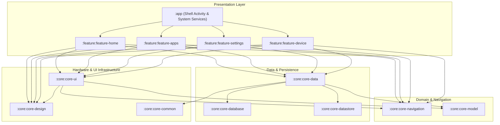

# LUNMED TV Architectural Specification

## 1. High-Level System Architecture

LUNMED TV is structured under Google's modern Android modularization guidelines, strictly enforcing unidirectional data flow (UDF), domain boundary encapsulation, and multi-module Gradle isolation.



---

## 2. Module Responsibilities

| Module | Scope & Responsibility | Key Components |
| :--- | :--- | :--- |
| `:app` | Shell activity, process bootstrap, Accessibility Watchdog, Boot & Device Admin Receivers. | `MainActivity`, `LunmedHomeWatchdogService`, `LunmedBootReceiver`, `LunmedDeviceAdminReceiver` |
| `:feature:feature-home` | Cinematic home screen, spotlight stage, application rails, clock header. | `HomeScreen`, `HomeViewModel`, `SpotlightCard`, `AppRail` |
| `:feature:feature-apps` | Polymorphic app grid, fast alphabet rail, search bar, app context dialogs. | `AppLibraryScreen`, `AppLibraryGridCard`, `AppLibraryAlphabetRail` |
| `:feature:feature-device` | Hardware diagnostics cockpit, SoC silicon badge, GPU vector wallpaper picker. | `DeviceCenterScreen`, `GaugeMetricCard`, `SiliconSoCChipBadge`, `WallpaperCard` |
| `:feature:feature-settings` | Visual appearance swatch gallery, Apple tvOS 18 Control Center overlay, root launcher switcher, ADB provisioning. | `SettingsScreen`, `AppleControlCenterOverlay`, `PaletteSwatchGallery`, `ScenicWallpaperShowcase` |
| `:core:core-navigation` | D-pad keycode mapping, 10-foot focus restoration, long-press handling. | `TvFocusManager`, `DpadKeyMap` |
| `:core:core-ui` | Shared UI components, top navigation bar, LRU artwork cache, ambient lighting. | `TopBar`, `AppArtworkCache`, `AmbientCanvas` |
| `:core:core-data` | High-level data repositories aggregating database, datastore, and hardware telemetry. | `InstalledAppsRepository`, `DeviceDiagnosticsRepository`, `UserPreferencesRepository`, `RootLauncherSwitcher` |
| `:core:core-database` | Local Room database for persistent favorites and application ordering. | `AppDatabase`, `FavoriteAppDao`, `FavoriteAppEntity` |
| `:core:core-datastore` | Preferences DataStore storing theme palettes, wallpaper profiles, and icon modes. | `UserPreferencesSerializer`, `UserPreferences` |
| `:core:core-design` | Design tokens, color palettes, typography, shapes, and elevation dimensions. | `LunmedTheme`, `LunmedPalette`, `LunmedTypography` |
| `:core:core-model` | Pure Kotlin domain models (no Android framework dependencies). | `AppInfo`, `DeviceTelemetry`, `SiliconChipInfo`, `ThemePalette` |
| `:core:core-common` | System dispatchers, coroutine scopes, and hardware platform utilities. | `LunmedDispatchers`, `HardwareCapabilities` |

---

## 3. Remote Control Focus Architecture (10-Foot UI)

1. **D-Pad Traversal:**
   - Elements request focus using Jetpack Compose `FocusRequester` and `Modifier.focusable()`.
   - Grid and rail layouts use lazy list focus restoration keys to preserve exact cursor indices across scroll cycles.
2. **Long-Press Handling & KeyUp Debouncing:**
   - To eliminate the common Android TV defect where releasing the remote center button after a long-press triggers the child click listener, long-press gestures consume the keyup event:
   - When a long-press triggers the contextual options menu, a temporal guard flag blocks the trailing `KeyEvent.ACTION_UP` from activating the underlying app launch.
3. **Alphabet Jump Rail:**
   - For remote controls without voice or keyboard inputs, `AppLibraryAlphabetRail` maps alphabetical letters directly to lazy grid scroll offsets, eliminating tedious multi-page scrolling.

---

## 4. Hardware Diagnostics Pipeline (Zero Mock Data)

Diagnostics read directly from Android Linux kernel and subsystem APIs:
- **RAM:** Sampled via `ActivityManager.getMemoryInfo(MemoryInfo)` for total physical bytes, available bytes, and low-memory thresholds.
- **Storage:** Queried through `StatFs(Environment.getDataDirectory().path)` calculating block size and available blocks.
- **Display:** Introspected via `DisplayManager` / `WindowManager` extracting physical `Display.Mode` dimensions, refresh rate, and HDR capabilities (`HDR10`, `HLG`, `DOLBY_VISION`).
- **SoC Silicon Identification:** Reads `/proc/cpuinfo`, `ro.board.platform`, `ro.hardware`, and `ro.chipname` to identify physical semiconductor dies without hardcoded mocks.

---

## 5. Persistent Default Launcher Defenses

To defeat aggressive vendor launchers on cheap white-label TV boxes, LUNMED TV deploys a 4-tier defense hierarchy:

```
[ Tier 1: RoleManager.ROLE_HOME (Android TV / Google TV Standard) ]
                         │
                         ▼
[ Tier 2: Root Launcher Switcher (su -c pm set-home-activity) ]
                         │
                         ▼
[ Tier 3: Accessibility Watchdog (LunmedHomeWatchdogService - 50ms Intercept) ]
                         │
                         ▼
[ Tier 4: Enterprise Device Owner (dpm set-device-owner Persistent Policy) ]
```

---

## 6. Strict Size & Memory Governance

- **APK Size Limit:** Strictly $\le$ 2.0 MB via R8 full-mode shrinking, resource trimming, and procedural vector drawing.
- **Memory Footprint:** Proactive eviction of `AppArtworkCache` on `TRIM_MEMORY_RUNNING_LOW` and `TRIM_MEMORY_MODERATE`.

